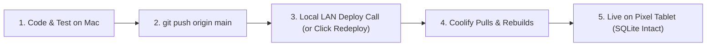

# Coolify Home Server Deployment Guide
**Target System**: Lenovo Mini PC (or any x86 / ARM Linux box) running fresh Ubuntu Server with LAN access.

---

## 0. Prerequisite: Lock a Static LAN IP on Your Router

Before installing anything, ensure your Lenovo Mini PC's LAN IP (`<SERVER_IP>`, e.g. `192.168.1.150`) never changes if your router or server reboots:

1. Find the Lenovo's current IP and MAC address:
   ```bash
   ip -br addr
   ```
2. Open your home router's admin page &rarr; **DHCP Reservations / Static Leases**, and pin that MAC address to a fixed IP (e.g. `192.168.1.150`).
   *(Why: Both your `sslip.io` domain and the Pixel Tablet's `chrome://flags` secure-origin whitelist depend on this IP staying constant.)*

---

## 1. Install Coolify on Ubuntu Server

Coolify provides an automated installer that provisions Docker, the Traefik reverse proxy, and the Coolify control plane.

1. **SSH into your Ubuntu server**:
   ```bash
   ssh your-username@<SERVER_IP>
   ```

2. **Ensure `curl` is installed and run the official installer**:
   ```bash
   sudo apt update && sudo apt install -y curl
   curl -fsSL https://cdn.coollabs.io/coolify/install.sh | sudo bash
   ```
   *The installer runs for ~2–3 minutes while pulling container images and initializing.*

3. **Access the Coolify Dashboard**:
   - Open your browser and navigate to:
     ```text
     http://<SERVER_IP>:8000
     ```
   - Complete the initial registration wizard by creating your local root administrator account (email & password).
   - When prompted for server type, choose **Localhost / This Server**.

---

## 2. Local DNS & Easy-to-Remember Domains

To run multiple apps without port numbers (`:8080`, `:3001`, etc.), Coolify's built-in Traefik reverse proxy routes traffic based on the domain name in the browser's request.

### Option A: "Magic" Local DNS via `sslip.io` (Recommended — Zero Configuration)
`sslip.io` is a free DNS service that resolves any domain containing an IP address back to that IP automatically across your entire home network:
- If your server's static LAN IP is `192.168.1.150`:
  - `hub.192.168.1.150.sslip.io` &rarr; resolves to `192.168.1.150`
  - `app2.192.168.1.150.sslip.io` &rarr; resolves to `192.168.1.150`
- **Why this is best**: Works immediately on your laptop, phones, and Pixel Tablet without touching router DNS settings or running Pi-hole.

### Option B: Router or Pi-hole Custom Local Domain (e.g. `*.home.arpa` or `*.lan`)
If you run Pi-hole, AdGuard Home, or a router that supports custom local DNS (pfSense / OPNsense / OpenWrt / UniFi):
1. Add a **Local DNS record**:
   ```text
   Domain: *.home.arpa  (or *.lan)
   IP:     <SERVER_IP>
   ```
2. Any subdomain (e.g. `hub.home.arpa`) will route directly to your mini PC.

> [!TIP]
> **For the Pixel Tablet PWA**:
> On your Pixel Tablet, open `chrome://flags/#unsafely-treat-insecure-origin-as-secure`, paste your chosen Hub URL (e.g. `http://hub.192.168.1.150.sslip.io`), set it to **Enabled**, and relaunch Chrome. You can also copy both URLs with one tap from **Settings (`•••`) &rarr; `install`** inside the Hub.

---

## 3. Connect Your GitHub Repository & Deploy Family Hub

1. In the Coolify sidebar, click **Projects** &rarr; **+ Add** (or open the **Default** project).
2. Inside your environment, click **+ Add Resource**:
   - Since `mile357/FamilyCoordination` is public, you can choose **Public Repository** and paste `https://github.com/mile357/FamilyCoordination` (zero auth required).
   - Or, for private repositories, choose **Private Repository (with Deploy Key)** or **GitHub App**.
3. **Select Build Settings**:
   - **Branch**: `main`
   - **Build Pack**: **Dockerfile** (Coolify automatically detects the `Dockerfile` in the repo).
4. **Configure Application Domain & Port**:
   - **Domains**: Enter your desired URL, e.g.:
     ```text
     http://hub.192.168.1.150.sslip.io
     ```
     *(or `http://hub.home.arpa`, or `http://<SERVER_IP>:8080` if using raw ports)*
   - **Port Exposes**: `8080`
5. **Set Your Local Timezone (Important for `.ics` Calendar Sync)**:
   - Open the **Environment Variables** tab in Coolify and add:
     ```text
     Key:   TZ
     Value: America/Los_Angeles
     ```
     *(Adjust to your local timezone so server-side `.ics` event windowing matches your wall clock.)*
6. **Configure Persistent Storage (Crucial for SQLite)**:
   - Open the **Storages** tab in Coolify.
   - Click **+ Add** &rarr; **Persistent Volume** *(use **Volume Mount**, not Host Directory Mount, so Docker preserves `UID 1000` write permissions on `/app/data`)*:
     - **Name**: `hub-data`
     - **Destination Path**: `/app/data`
   - *This ensures `hub.db` is stored safely on the host SSD and never erased when the container rebuilds.*
7. Click **Deploy**.

Coolify will clone your repo, build the Alpine image, mount the SQLite volume, and configure Traefik. In ~30 seconds, your hub is live.

---

## 4. Auto-Deploying on a Private Home LAN (`192.168.1.x`)

> [!IMPORTANT]
> **Why GitHub Cloud Webhooks Need a Helper on Private LANs**:
> Because `192.168.1.150` is a private LAN address behind your home router, GitHub's cloud servers cannot reach into your home network to deliver push webhooks directly unless you use one of the two methods below.

### Method A: Pure Local LAN Trigger from Your Mac (Recommended — Zero Internet Exposure)
Since your Mac is on the same Wi-Fi as the Lenovo Mini PC, your Mac can trigger Coolify's local deploy API directly whenever you push:

1. In Coolify, go to **Keys & Tokens** &rarr; **API Tokens**, enable the API, and create a token (e.g. `mac-deploy`).
2. Copy your application's **Deploy Webhook URL** from the application's **Webhooks** tab in Coolify (it looks like `http://192.168.1.150:8000/api/v1/deploy?uuid=<APP_UUID>&force=false`).
3. Add a `deploy` alias or shell function on your Mac (or trigger it right after `git push`):
   ```bash
   curl -s -H "Authorization: Bearer <YOUR_COOLIFY_TOKEN>" \
     "http://192.168.1.150:8000/api/v1/deploy?uuid=<APP_UUID>&force=false"
   ```
   *(Or simply click the **Redeploy** button in the Coolify UI at `http://192.168.1.150:8000`.)*

### Method B: Cloudflare Tunnel (If You Want Cloud GitHub Webhooks)
If you own a domain on Cloudflare, Coolify has a built-in **Cloudflare Tunnel (`cloudflared`)** integration under **Servers &rarr; Cloudflare Tunnels**. That lets GitHub deliver webhooks to Coolify without opening any ports on your home router.

---

## 5. The Day-to-Day "Vibe Coding" Loop


